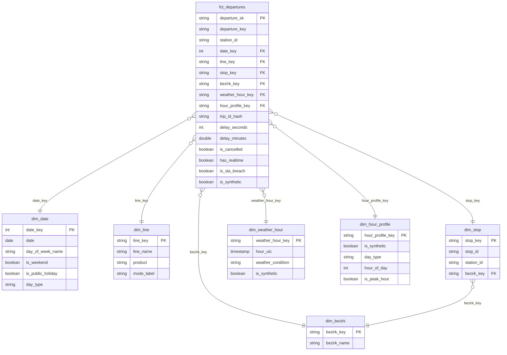

# Data dictionary

This is the reference for the Gold layer (Kimball star schema) of the Berlin Transit SLA Reliability Engine.
For every table I state the **grain** (what one row means) in plain words, then the columns. The business rules
come from [ADR-002](adr/002-ingestion-architecture.md) and are copied below so this page stands on its own.

How the layers fit together, using a café as the picture:

- **RAW** is the pile of till receipts exactly as they came in.
- **Silver (staging)** is the tidied pile: duplicates removed, times in Berlin time, IDs hashed.
- **Gold (marts)** is the daily sales report: one fact table of receipt lines, surrounded by small lookup tables
  (the menu) that explain the codes.

## 1. Definitions (from ADR-002)

| Term | Definition |
|------|-----------|
| **Departure event** | One planned departure of one trip from one stop (`tripId` + stop + planned time). |
| **Latest prediction wins** | A departure is seen in several polls; I keep the reading from the **latest** poll before departure, because it is closest to what really happened. |
| **SLA breach** | Departure delay **> 300 seconds (more than 5 minutes)**. |
| **Cancelled** | VBB marks the departure `cancelled = true`. Counted separately, not as a breach. |
| **No realtime** | `delay` is empty (no live data). Counted, but excluded from the breach rate. |
| **Breach rate** | Breaches ÷ departures that have realtime data and are not cancelled. |
| **Weather condition** (per hour, first match wins) | Snow = snowfall > 0 cm · Rain = precipitation ≥ 0.5 mm · Windy = wind speed ≥ 30 km/h · Clear = everything else. |
| **Peak (rush) hour** | Computed from data, separately for **weekdays** and **weekends**: an hour of the day is a peak hour when its average number of scheduled departures is in the **top 25 %** of hours for that day type. |
| **Day type** | `is_weekend` (Saturday/Sunday) and `is_public_holiday` (Berlin public holidays from a fixed reference list). |
| **Empty poll** | A poll that succeeds but returns 0 departures (normal at night). Logged as `ok_empty`, not as an error. |
| **Coverage** | Successful polls ÷ expected polls (96 per station per day). It shows late or skipped scheduled runs. |
| **Synthetic data** | A generated 14-day practice dataset, flagged `is_synthetic = true` and always reported separately from real data. |

How I implemented the two rules that needed a technical choice:

- **Day type** has two values: `weekday`, and `weekend_or_holiday` (Saturday, Sunday or a Berlin public holiday).
  A public holiday behaves like a Sunday on the roads, so it is grouped with the weekend.
- **Peak hour** uses `PERCENT_RANK()` over the 24 hours of each source and day type, ordered by average scheduled
  departures per day. An hour is a peak hour when its percent rank is at least 0.75, which gives 6 of 24 hours.
  Hours that tie share a rank, so a tie at the border can add a seventh peak hour.

## 2. Star schema

Two reporting tables sit on top of the star: `mart_sla_breach_summary` (the dashboard table) and
`mart_data_quality` (the collector reliability scoreboard).

## 3. Fact table

### fct_departures

**Grain: one row per departure event**, meaning one planned departure of one trip from one stop, seen from one
polled station (`departure_key` + `station_id`), per data source (real or synthetic).
It is loaded incrementally with a MERGE on `departure_sk`, so re-running never creates duplicates and the latest
prediction overwrites older ones.

| Column | Meaning |
|--------|---------|
| `departure_sk` | Primary key: hash of departure_key + station_id + is_synthetic. |
| `departure_key` | Collector fingerprint of trip + stop + planned time. |
| `station_id` | The polled station. |
| `date_key` | FK to dim_date (Berlin date of the planned departure, `yyyymmdd`). |
| `line_key` | FK to dim_line. |
| `stop_key` | FK to dim_stop. |
| `bezirk_key` | FK to dim_bezirk (`000` = Unknown). |
| `weather_hour_key` | FK to dim_weather_hour (`-1` = no weather reading for that hour). |
| `hour_profile_key` | FK to dim_hour_profile (source + day type + hour). |
| `trip_id_hash`, `vehicle_trip_number_hash` | Salted SHA-256 of the trip ID and vehicle trip number. The raw values stop in Silver. |
| `planned_departure_utc` | Planned time in UTC. |
| `planned_departure_berlin` | Planned time as Berlin clock time (CET/CEST). |
| `predicted_departure_berlin` | Predicted time as Berlin clock time, empty without realtime. |
| `hour_of_day` | Berlin hour (0-23) of the planned time. |
| `last_polled_at_utc` | Newest poll that saw this departure. Drives the incremental window. |
| `delay_seconds` | Delay in seconds, negative = early, empty without realtime. |
| `delay_minutes` | `delay_seconds / 60`, rounded to 2 decimals. |
| `is_cancelled` | VBB marked it cancelled. |
| `has_realtime` | A delay value exists. |
| `is_sla_breach` | Not cancelled and `delay_seconds > 300`. |
| `is_synthetic` | True for the practice dataset. |

## 4. Dimension tables

### dim_date
**Grain: one row per Berlin calendar day**, 2025-01-01 to 2027-12-31.
Columns: `date_key` (PK, yyyymmdd), `date`, `year_number`, `month_number`, `day_of_week_name`, `iso_day_number`
(Monday = 1), `is_weekend`, `is_public_holiday`, `public_holiday_name`, `day_type` (`weekday` or `weekend_or_holiday`).
Holidays come from the `berlin_public_holidays` seed, which includes the one-off holiday on 8 May 2025.

### dim_line
**Grain: one row per line and mode** (`line_name` + `product`).
Columns: `line_key` (PK), `line_name`, `product` (suburban, subway, tram, bus), `mode_label` (S-Bahn, U-Bahn, Tram, Bus).

### dim_stop
**Grain: one row per polled station and stop** (`station_id` + `stop_id`).
Columns: `stop_key` (PK), `stop_id`, `stop_name`, `latitude`, `longitude`, `station_id`, `bezirk_key` (FK), `bezirk_name`.
The Bezirk is found with point-in-polygon: the stop GPS point is tested against each district outline.
A stop outside every outline gets `000` / Unknown.

### dim_bezirk
**Grain: one row per Berlin district**, 12 official Bezirke plus one Unknown row.
Columns: `bezirk_key` (PK, the official code, `000` = Unknown), `bezirk_code`, `bezirk_name`.

### dim_weather_hour
**Grain: one row per hour of weather per data source**, plus one `unknown` row for hours without a reading.
Columns: `weather_hour_key` (PK, `-1` = unknown), `hour_utc`, `hour_berlin`, `date_berlin`, `hour_of_day_berlin`,
`weather_condition` (snow, rain, windy, clear, unknown), `temperature_c`, `precipitation_mm`, `rain_mm`,
`snowfall_cm`, `wind_speed_kmh`, `wind_gusts_kmh`, `is_forecast`, `is_synthetic`.

### dim_hour_profile
**Grain: one row per data source x day type x hour of day (0-23).**
Columns: `hour_profile_key` (PK), `is_synthetic`, `day_type`, `hour_of_day`, `avg_scheduled_departures`
(average per day with data, all stations), `busyness_percent_rank` (0 = quietest hour, 1 = busiest),
`is_peak_hour` (rank >= 0.75).
Real data covers only a few days so far, so its peak hours are not meaningful until more days accumulate.

## 5. Reporting marts

### mart_sla_breach_summary
**Grain: one row per Berlin date x hour of day x Bezirk x line x weather condition x is_synthetic.**
Every departure falls in exactly one bucket: cancelled, no realtime, or rated.

| Column | Meaning |
|--------|---------|
| `summary_key` | Primary key (hash of the grain). |
| `date`, `date_key`, `hour_of_day` | When. |
| `bezirk_name`, `line_name`, `mode_label` | Where. |
| `weather_condition` | Why (snow, rain, windy, clear, or unknown when the hour has no weather reading). |
| `is_synthetic` | Real or practice data. Never mixed. |
| `day_type`, `is_peak_hour` | Weekday or weekend/holiday, and whether the hour is a data-driven peak hour. |
| `scheduled_departures` | All departures in the group. |
| `cancelled_departures` | Marked cancelled. |
| `no_realtime_departures` | Not cancelled, no delay value. |
| `rated_departures` | Not cancelled, has a delay value. The denominator of the breach rate. |
| `breach_departures` | More than 300 seconds late. |
| `breach_rate` | `breach_departures / rated_departures`. |
| `avg_delay_minutes` | Average delay in minutes over non-cancelled departures with realtime data. |

### mart_data_quality
**Grain: one row per Berlin date x data source (`is_synthetic`).** This is the data reliability scoreboard.

| Column | Meaning |
|--------|---------|
| `quality_key` | Primary key (hash of date + source). |
| `date`, `is_synthetic`, `is_partial_day` | Day, source, and whether the day is still in progress. |
| `polls_expected` | 96 polls per station per day x number of stations (real data only). |
| `polls_logged`, `polls_ok`, `polls_ok_empty`, `polls_error` | What the poll logbook recorded. |
| `coverage_pct` | `100 x (polls_ok + polls_ok_empty) / polls_expected`. |
| `rows_received`, `rows_valid`, `duplicates_dropped` | Row counts from the logbook (real data only). |
| `rows_quarantined` | Records rejected by the data contract. |
| `departures_in_silver` | Departures left after de-duplication. |
| `quarantined_<reason>` | Rejects by simplified reason: missing_planned_time, implausible_delay, out_of_scope_product, bad_coordinates, not_an_object, weather_reading, other. |

Synthetic rows have no poll logbook, so their poll and logbook columns are empty.

## 6. Privacy

`trip_id` and `vehicle_trip_number` are replaced in Silver by a salted SHA-256 hash (the salt comes from the
`DBT_HASH_SALT` environment variable). Think of a library card number: two records can be matched by it, but nobody
can read a name from it. The raw IDs are not present in any Gold table, and the quarantine payload (which holds them)
is not carried out of RAW.
